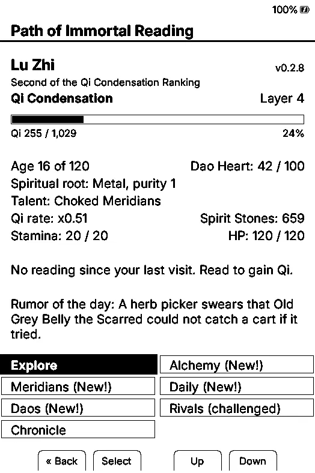
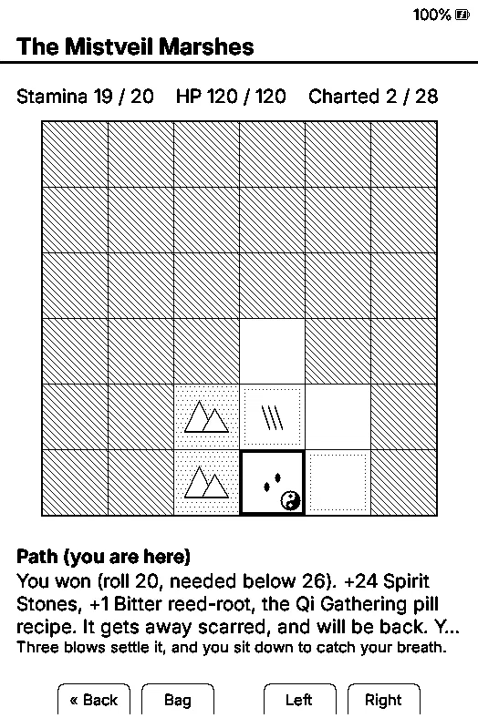
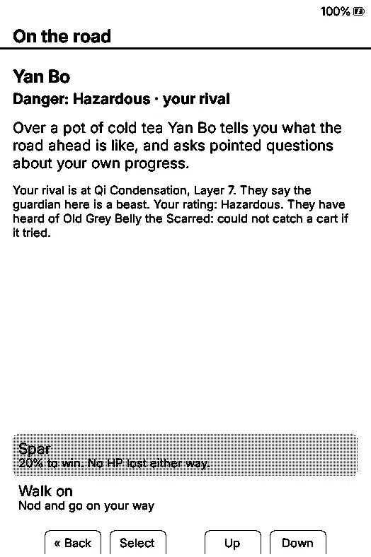
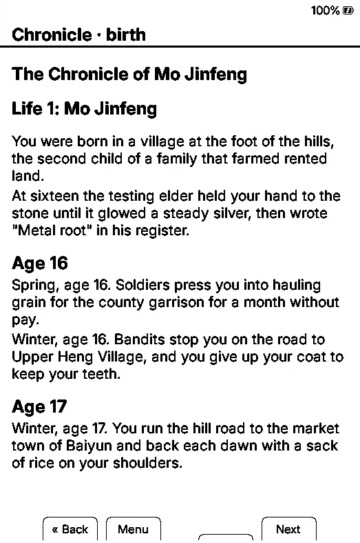

# Path of Immortal Reading

**A personal fork of CrossInk that adds a Xianxia cultivation game for your e-reader that grows when you read.** 

<table>
  <tr>
    <td align="center"> <em>Your cultivator</em></td>
    <td align="center"> <em>Exploring a region</em></td>
    <td align="center"> <em>Meeting your rival</em></td>
    <td align="center"> <em>The Chronicle</em></td>
  </tr>
</table>

Path of Immortal Reading is a small cultivation game built into the firmware of your e-reader. Every minute you spend reading becomes Qi, Spirit Stones and stamina. Open the game for a minute or two between chapters, collect what your reading earned, make a few choices, and go back to your book.

Nothing happens while the book is closed, and nothing is lost either: no decay, no raids, no penalty for a week away. Time in the game passes only as you read, one in-game year for every hour.

## What's in it

- **Realms and breakthroughs:** rise from Body Tempering through Qi Condensation, Foundation Establishment, Core Formation and beyond, with bottlenecks, grades, Great Perfection, tribulations and Heart Demons.
- **Techniques from your books:** every book you finish becomes a technique scroll, named and graded by how long and how you read it.
- **Exploration:** a region opens with each realm, a 6×6 map under fog with herbs, ruins, caves, merchants, beasts, bandits and a guardian. Regions regrow and reshape over time.
- **Alchemy:** gather ingredients, discover recipes and brew pills while you read.
- **Meridians and Daos:** open acupoints for a faster Qi rate, and find Daos that grow from your reading habits.
- **Daily omens and tasks**, scaled to how much you usually read.
- **Your rival:** a cultivator of your own age who trains every day, plus a ranking of twenty to climb in each realm.
- **Nemeses:** enemies who beat you may come back, stronger and with habits of their own to discover.
- **Wounds that matter:** fight low on HP and you fight worse; lose with your last HP and you come to at the region's entrance, with nothing taken.
- **The Chronicle:** your character's whole life, written as you go, readable as a book in the reader.
- **Lives and rebirth:** each realm gives a lifespan. From Foundation Establishment you can reincarnate into a new world, carrying imprints, legacy perks and a small Qi bonus from your best realm; every past life's Chronicle is kept.
- **A collection:** a codex that fills as your lineage sees more, and 64 mementos to find across lives. Cosmetic only.
- **A Guide in the game** that explains how reading turns into progress, with more topics as the game opens up.
- **Fair to every reader:** night or morning, daily or weekends only, fast or slow pages, all earn the same power. Only time spent reading counts, and only on this device.

## How reading time is counted

The game uses CrossInk's own reading stats, from this device only:

- Time on a page counts when you turn to the next page. A page left open longer than the idle limit (5 minutes by default, set in **Settings > System > Reading Stats > Idle Time Threshold**) counts nothing at all, so a book left open overnight earns nothing.
- Reading stats must be on (**Track Reading Stats**, on by default).

## Install

1. Download the `.bin` for your device from the [latest release](https://github.com/CygRyu/CrossInk-XN/releases/latest):

|Device|File|
|-|-|
|Xteink X3 or X4|`firmware-x3-x4-cultivation-v0.3.0.bin`|
|Xteink X4 Pro|`firmware-x4-pro-cultivation-v0.3.0.bin`|
|Xteink X4 Classic|`firmware-x4-classic-cultivation-v0.3.0.bin`|
|Seeed Studio Sticky|`firmware-sticky-cultivation-v0.3.0.bin`|

2. Flash it. If your reader already runs CrossInk, copy the file to the SD card and choose **Settings > System > SD Card Firmware Update**. Otherwise see the [command line instructions](./docs/installation.md#command-line).
3. Set the date and time in the settings. The daily systems, your rival and the ranking need them.
4. Open **Cultivation** from the Home menu and create your character. Reading done before that moment does not count; everyone starts at zero.

To see your cultivator whenever the reader sleeps, choose **Cultivator** under **Settings > Display > Sleep Screen**.

Your save lives on the SD card (`/.crosspoint/cultivation/`) and carries over to new versions. To go back to plain CrossInk, flash its firmware again; the save stays on the card.

## Based on CrossInk

This firmware is [CrossInk](https://github.com/uxjulia/CrossInk) v1.6.1 with the game added. Everything CrossInk does is still there: the reader, fonts, themes, reading stats, bookmarks, sleep screens and settings. The game lives in its own menu entry and changes nothing about how you read. The one difference: CrossInk's screens are in English only in this build, to leave room for the game.

To go back to plain CrossInk, download its firmware for your device from the [CrossInk releases](https://github.com/uxjulia/CrossInk/releases) and install it the same way, with **SD Card Firmware Update**. Your books, settings, reading stats and the game's save all stay on the card, so you can come back to the game later where you left off.

## Status

A personal project in active development. Only tested on a real **Xteink X3**; the other builds compile and should work, but have not been tried on a device. On readers whose clock drifts in sleep (the X4 family), date-based features may be less reliable.

## Community

Join the [Discord server](https://discord.gg/aTMRnugDTt) to chat with other cultivators, ask for help with installing, share your breakthroughs and nemesis stories, report bugs and suggest ideas. Game updates are announced there first.

## Credits

Built on [CrossInk](https://github.com/uxjulia/CrossInk), itself a fork of [CrossPoint Reader](https://github.com/crosspoint-reader/crosspoint-reader). Both are MIT-licensed; see [LICENSE](./LICENSE). This is an unofficial fork. 
You can report game problems here on GitHub or in the #bugs channel on [Discord](https://discord.gg/aTMRnugDTt), not to CrossInk or CrossPoint.

## Support this project

If the game keeps you reading, you can support its development on Ko-fi:

